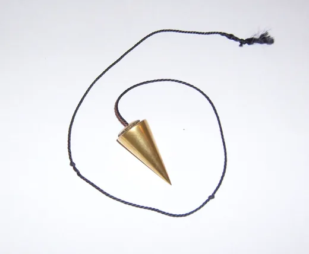
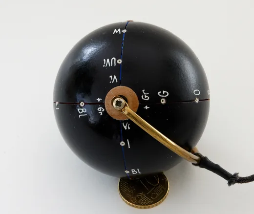
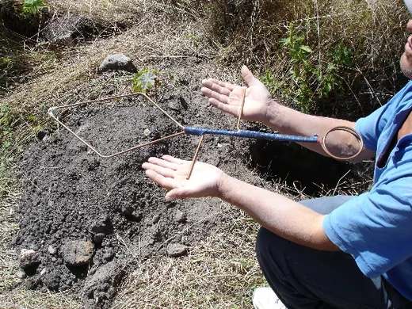
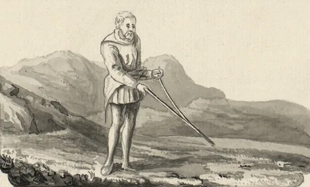
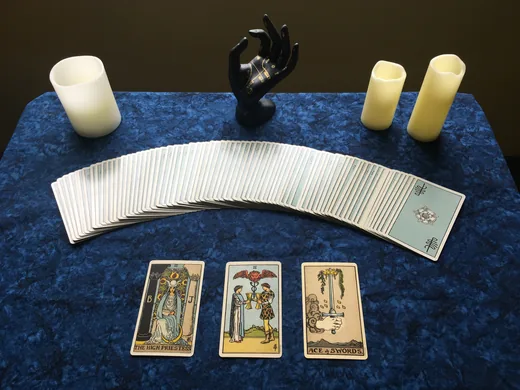

# Bildnachweis — Radiästhesie, Pendeln und Orakel

Automatisch erzeugt aus `media-manifest.json` (Stand 2026-11-02T23:27:43Z, Quellen abgerufen am 2026-11-03). Nicht von Hand bearbeiten.

6 Motive, 24 Varianten, 4 eigene Zeichnungen.

## Motive

### Klassisches Pendel (rad-media-01)

*Kegelpendel aus Messing an geflochtener Kordel — die verbreitetste Bauform. Das Objekt ist ein Alltagsgegenstand; das Foto belegt keine Wirkung.*

- **Urheber:** Carivaldi — https://commons.wikimedia.org/wiki/User:Carivaldi
- **Lizenz:** CC BY-SA 3.0 — https://creativecommons.org/licenses/by-sa/3.0/
- **Attributionspflicht:** ja
- **ShareAlike:** ja
- **Originalseite:** https://commons.wikimedia.org/wiki/File:Radiesthetic_pendulum.jpg
- **Stand der Seite:** 2024-07-29T06:35:00Z (revid 904548060)
- **Original:** image/jpeg, 1784×1468 px, 168315 B, SHA-1 `1147b6087129a520463046ee012b1abce9f05aef`
- **Verändert:** Skaliert (LANCZOS) auf 520 px und 1040 px Breite, nach WebP überführt, EXIF entfernt, ICC-Profil beibehalten, nicht beschnitten.
- **Länderhinweis:** Keine länderspezifische Besonderheit bekannt. Die Datei ist zusätzlich unter GFDL lizenziert; genutzt wird die CC-BY-SA-3.0-Option.

**Attributionszeile:** Carivaldi, „Klassisches Pendel“, CC BY-SA 3.0, via Wikimedia Commons (verändert: skaliert und ins WebP-Format überführt)

Bearbeitungen (Skalierung, Formatwechsel) sind Weitergaben unter gleichen Bedingungen: Die Varianten stehen ebenfalls unter CC BY-SA 3.0 und nennen Urheber und Änderung.

### Universalpendel (rad-media-02)

*Universalpendel: Kugelkörper mit aufgedruckten Buchstaben und Messingstab, laut Bildbeschreibung Ergebnis der Arbeiten von de Belizal, Chaumery und Morel. Die Münze dient nur dem Grössenvergleich.*

- **Urheber:** Wouter Hagens — https://commons.wikimedia.org/wiki/User:Wouterhagens
- **Lizenz:** CC BY-SA 3.0 — https://creativecommons.org/licenses/by-sa/3.0/
- **Attributionspflicht:** ja
- **ShareAlike:** ja
- **Originalseite:** https://commons.wikimedia.org/wiki/File:Universal_pendulum_E.jpg
- **Stand der Seite:** 2026-05-09T06:43:52Z (revid 1211018461)
- **Original:** image/jpeg, 2108×1776 px, 1655496 B, SHA-1 `a7da8420c903c7ef20acb7b675a2108f6df77d9f`
- **Verändert:** Skaliert (LANCZOS) auf 520 px und 1040 px Breite, nach WebP überführt, EXIF entfernt, ICC-Profil beibehalten, nicht beschnitten.
- **Länderhinweis:** Keine länderspezifische Besonderheit bekannt.
- **Marke:** „Universalpendel“ ist eine Gerätebezeichnung aus der Radiästhesie-Literatur; keine Prüfung einer allfälligen Marke erfolgt, die Bezeichnung wird rein beschreibend verwendet.

**Attributionszeile:** Wouter Hagens, „Universalpendel“, CC BY-SA 3.0, via Wikimedia Commons (verändert: skaliert und ins WebP-Format überführt)

Die Buchstaben auf der Kugel sind Teil eines Deutungssystems, keine Messskala. Die Varianten stehen unter CC BY-SA 3.0.

### Radiästhesierute (Winkelrute) (rad-media-03)

*Winkelrute mit blau lackiertem Griffstück und zwei Messingarmen, im Gelände gehalten. Das Foto zeigt die Handhabung, nicht das Ergebnis einer Messung.*

- **Urheber:** José Antonio Agraz Sandoval — https://commons.wikimedia.org/wiki/Special:ListFiles/Jos%C3%A9_Antonio_Agraz_Sandoval
- **Lizenz:** CC0 1.0 — https://creativecommons.org/publicdomain/zero/1.0/deed.de
- **Attributionspflicht:** nein (freiwillige Nennung)
- **ShareAlike:** nein
- **Originalseite:** https://commons.wikimedia.org/wiki/File:Varilla_de_radiestesia.JPG
- **Stand der Seite:** 2026-01-04T08:33:31Z (revid 1141593234)
- **Original:** image/jpeg, 566×425 px, 335929 B, SHA-1 `40a58fb0b29e07d3ada3ce21354467b091df5692`
- **Verändert:** Skaliert (LANCZOS) auf 520 px und 1040 px Breite, nach WebP überführt, EXIF entfernt, ICC-Profil beibehalten, nicht beschnitten.
- **Länderhinweis:** CC0 ist ein weltweiter Rechteverzicht; keine länderspezifische Einschränkung bekannt. Die Nennung des Urhebers erfolgt hier freiwillig.

**Attributionszeile:** José Antonio Agraz Sandoval, „Radiästhesierute (Winkelrute)“, CC0 1.0, via Wikimedia Commons (verändert: skaliert und ins WebP-Format überführt)

Das Original ist mit 566 × 425 px klein; es wird deshalb nur eine 520-px-Variante erzeugt und nicht hochskaliert. Für eine grossformatige Verwendung ist das Bild nicht geeignet.

### Historische Wünschelrute (rad-media-04)

*Wünschelrute in einer Zeichnung aus dem erweiterten Exemplar von Thomas Pennants „A Tour in Wales“ (Ausgabe 1781), National Library of Wales. Gemeinfrei.*

- **Urheber:** Thomas Pennant (1726–1798), laut Dateiseite; Vorlage: National Library of Wales — https://commons.wikimedia.org/wiki/File:Divining_Rod.jpg
- **Lizenz:** Public Domain (PD-old) — https://commons.wikimedia.org/wiki/Template:PD-old
- **Attributionspflicht:** nein (freiwillige Nennung)
- **ShareAlike:** nein
- **Originalseite:** https://commons.wikimedia.org/wiki/File:Divining_Rod.jpg
- **Stand der Seite:** 2026-05-02T11:11:19Z (revid 1207052185)
- **Original:** image/jpeg, 1232×741 px, 1110391 B, SHA-1 `b29c59be770ee6ec6b98a3e7c47c70f53f97a53c`
- **Verändert:** Skaliert (LANCZOS) auf 520 px und 1040 px Breite, nach WebP überführt, EXIF entfernt, ICC-Profil beibehalten, nicht beschnitten.
- **Länderhinweis:** Gemeinfrei weltweit: Der Urheber starb 1798, die Schutzfrist von 70 Jahren nach dem Tod ist in allen relevanten Rechtsordnungen abgelaufen.

**Attributionszeile:** Thomas Pennant (1726–1798), laut Dateiseite; Vorlage: National Library of Wales, „Historische Wünschelrute“, Public Domain (PD-old), via Wikimedia Commons (verändert: skaliert und ins WebP-Format überführt)

Die Dateiseite nennt als Urheber Thomas Pennant, obwohl die Beschreibung von Zeichnungen durch Moses Griffiths, Ingleby und weitere Künstler spricht. Wer das vorliegende Blatt gezeichnet hat, ist dort nicht eindeutig bestimmt — die Zuschreibung bleibt unsicher. Für die Gemeinfreiheit ist das ohne Belang, für die Bildunterschrift schon: Sie nennt deshalb die Publikation, nicht einen einzelnen Zeichner.

### Tarot — Drei-Karten-Legung (rad-media-05)

*Drei-Karten-Legung mit dem Rider-Waite-Smith-Deck (Ausgabe Smith-Waite Centennial): Die Hohepriesterin, Zwei der Kelche, Ass der Schwerter.*

- **Urheber:** Nosferattus — https://commons.wikimedia.org/wiki/User:Nosferattus
- **Lizenz:** CC0 1.0 — https://creativecommons.org/publicdomain/zero/1.0/deed.de
- **Attributionspflicht:** nein (freiwillige Nennung)
- **ShareAlike:** nein
- **Originalseite:** https://commons.wikimedia.org/wiki/File:Tarot_cards_-_3_card_spread_with_candles.jpg
- **Stand der Seite:** 2026-05-24T04:29:47Z (revid 1219272290)
- **Original:** image/jpeg, 3200×2400 px, 1861604 B, SHA-1 `631451d33eed4381273b04fe61851d276c3a0221`
- **Verändert:** Skaliert (LANCZOS) auf 520 px und 1040 px Breite, nach WebP überführt, EXIF entfernt, ICC-Profil beibehalten, nicht beschnitten.
- **Länderhinweis:** Das Foto ist CC0. Die abgebildeten Kartenmotive sind Reproduktionen des 1909 erschienenen Rider-Waite-Smith-Decks (Zeichnungen: Pamela Colman Smith, gestorben 1951). Nach deutschem und EU-Recht endete die Schutzfrist Ende 2021; in den USA ist das Deck seit Langem gemeinfrei. Die Kartenrückseite und Eigenleistungen der Neuausgabe sind nicht abgebildet.
- **Marke:** „Smith-Waite Centennial“ und „Rider-Waite-Smith“ sind Bezeichnungen von Verlagen; sie werden hier nur zur Identifikation des abgebildeten Decks genannt.

**Attributionszeile:** Nosferattus, „Tarot — Drei-Karten-Legung“, CC0 1.0, via Wikimedia Commons (verändert: skaliert und ins WebP-Format überführt)

Die Legung ist gestellt. Das Bild dokumentiert eine verbreitete Praxis, nicht deren Treffsicherheit.

### Historisches Ouija-Brett (rad-media-06)

*Ouija-Brett der Kennard Novelty Company, Baltimore, um 1890. Gemeinfrei; die Bezeichnung „Ouija“ ist als Marke geschützt — das Bild zeigt ein historisches Objekt, keine Produktempfehlung.*

- **Urheber:** Elijah Bond (1847–1921) und Charles Kennard (1856–1925) — https://commons.wikimedia.org/wiki/File:Ouija_board_-_Kennard_Novelty_Company.png
- **Lizenz:** Public Domain (PD-Art / PD-old-70-1923) — https://commons.wikimedia.org/wiki/Template:PD-Art
- **Attributionspflicht:** nein (freiwillige Nennung)
- **ShareAlike:** nein
- **Originalseite:** https://commons.wikimedia.org/wiki/File:Ouija_board_-_Kennard_Novelty_Company.png
- **Stand der Seite:** 2026-05-03T10:10:09Z (revid 1207650742)
- **Original:** image/png, 4928×3290 px, 22414749 B, SHA-1 `6eb9db8791e3779c0135f8e1dc44d0296cb392ef`
- **Verändert:** Skaliert (LANCZOS) auf 520 px und 1040 px Breite, nach WebP überführt, EXIF entfernt, ICC-Profil beibehalten, nicht beschnitten. Zusätzlich PNG-Fassung mit erhaltenem Alphakanal.
- **Länderhinweis:** Die Dateiseite traegt {{PD-Art|PD-old-70-1923}} — nicht, wie in der Ausgangsliste vermerkt, eine Public-Domain-Mark. Beide Wege führen zu gemeinfrei, der genaue Baustein ist aber PD-old-70-1923. PD-Art ist am US-Recht ausgerichtet; für Deutschland und die EU greift § 64 UrhG: Bond starb 1921, Kennard 1925, die 70-Jahres-Frist endete 1992 bzw. 1996. Das Werk ist in beiden Rechtsordnungen gemeinfrei.
- **Marke:** „Ouija“ ist eine eingetragene Marke (Hasbro). Die Gemeinfreiheit des historischen Bretts berührt das Markenrecht nicht. Zulässig ist die beschreibende Verwendung als historisches Dokument; das Bild darf nicht als Herkunfts- oder Qualitätshinweis für Produkte dienen.

**Attributionszeile:** Elijah Bond (1847–1921) und Charles Kennard (1856–1925), „Historisches Ouija-Brett“, Public Domain (PD-Art / PD-old-70-1923), via Wikimedia Commons (verändert: skaliert und ins WebP-Format überführt)

Das Brett ist freigestellt (Alphakanal mit echter Transparenz). Die Varianten behalten den Alphakanal; JPEG kommt dafür nicht in Frage, weil es keine Transparenz kennt.

## Eigene Zeichnungen

- `assets/radiasthesie/pendel-geometrie.svg` — Pendelgeometrie — Eigenwerk (Projekt Esoterik-Welt)
- `assets/radiasthesie/pendeltafel.svg` — Pendeltafel — Eigenwerk (Projekt Esoterik-Welt)
- `assets/radiasthesie/winkelrute.svg` — Winkelrute in Aufsicht — Eigenwerk (Projekt Esoterik-Welt)
- `assets/radiasthesie/orakel-karten.svg` — Orakelkarten — Eigenwerk (Projekt Esoterik-Welt)

## Offene Punkte

- Keine LICENSE-Datei im Repository: die Lizenz der eigenen SVGs und der Projektinhalte ist nicht formal festgelegt.
- Pfadabweichung zu RAD-01/INTEGRATIONSPUNKTE.md §2.5: dort sind assets/radiasthesie/fotos/ und assets/radiasthesie/media-manifest.json vorgesehen. Diese Karte schreibt assets/radiasthesie/media/ vor. Bewusst genau eine Manifestdatei unter assets/radiasthesie/media/media-manifest.json — eine Kopie an zweiter Stelle wäre eine zweite Wahrheit. RAD-06 muss diesen Pfad lesen.
- Das Ouija-Logo ist bei 520 px nicht sicher zu entziffern; der Alt-Text beschreibt es deshalb, ohne es zu lesen.
- Die Zuschreibung des Wünschelruten-Blattes an Thomas Pennant ist laut Dateiseite unsicher (Beschreibung nennt mehrere Zeichner).
- Die Bilder sind noch nicht in js/data/radiasthesie.js eingebunden — das ist Integrationsumfang (RAD-06), nicht dieser Karte.
- AVIF ist erzeugt, aber noch von keiner Ansicht ausgeliefert; der Einbau braucht <picture>/<source>.
- Für die Auslieferung fehlt eine Bildnachweisseite im Seitenbau; hier liegt sie als generierte Datei bereit.
- Bei den beiden CC-BY-SA-3.0-Motiven muss die Weitergabe unter gleichen Bedingungen sichtbar werden (Impressum- oder Bildnachweishinweis).
