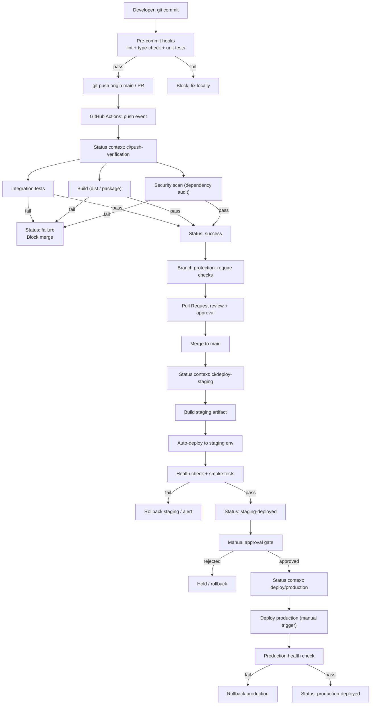

# CI/CD Pipeline Architecture — Hermes Adaptive Router

> Status: Design spec  |  Branch: `wt/t_fc0d4b4d`  |  Workspace: `hermes-adaptive-router`
> Target repo: `ingbms/hermes-adaptive-router` (private by default)

## 1. Overview

The pipeline covers four state transitions for every commit/push in the adaptive-router plugin repository:

1. **Commit validation** — local / pre-commit checks (lint, type-check, unit tests)
2. **Push verification** — CI gate on `push` (integration tests, build, security scan)
3. **Deploy staging** — automated deploy to staging env upon merge to `main`
4. **Deploy production** — manual approval + deploy to production env

---

## 2. Pipeline Stages (Mermaid)



---

## 3. Required Status Contexts (GitHub Checks API)

Every stage writes a required status to the repository for branch-protection gating:

| Context ID | Stage | Trigger | Required? | Description |
|---|---|---|---|---|
| `lint` | Commit validation | `pre-commit` / `pull_request` | Yes | `ruff` / `flake8` + import order |
| `type-check` | Commit validation | `pre-commit` / `pull_request` | Yes | `mypy` on `adaptive_router/` |
| `unit-tests` | Commit validation | `pre-commit` / `pull_request` | Yes | `pytest tests/` |
| `integration-tests` | Push verification | `push` / `pull_request` | Yes | Full `tests/` + benchmark smoke |
| `build` | Push verification | `push` / `pull_request` | Yes | `python -m build` + dashboard `npm build` |
| `security-scan` | Push verification | `push` / `pull_request` | Yes | `pip-audit` + `npm audit` |
| `depl staging` | Deploy staging | `push` to `main` | No | Auto-deploy result |
| `deploy/production` | Deploy production | `workflow_dispatch` | Yes (manual) | Manual approval + deploy result |

---

## 4. Branch Protection Rules

Applied to `main` in `ingbms/hermes-adaptive-router`:

| Rule | Value | Rationale |
|---|---|---|
| Require PR reviews | `1` minimum | Code quality for plugin interface |
| Dismiss stale PR approvals | On | Prevent stale approvals after new pushes |
| Require status checks to pass | `lint`, `type-check`, `unit-tests`, `integration-tests`, `build`, `security-scan` | Prevent broken / unverified code on `main` |
| Require branches to be up to date | Yes | Force rebase before merge |
| Require signed commits | Optional (recommended) | Provenance for private repo |
| Restrict pushes to `main` | Direct push blocked; PR only | Protect deploy pipeline |
| Require linear history | Optional | Simplify rollback to any commit |

---

## 5. Environment Promotion Gates

### 5.1 Commit → Push Gate
- All 3 commit-validation contexts (`lint`, `type-check`, `unit-tests`) pass.
- Developer pushes; GitHub triggers `push` event.

### 5.2 Push → Merge Gate
- All 3 push-verification contexts (`integration-tests`, `build`, `security-scan`) pass.
- PR approved by 1 reviewer.
- Branch is up-to-date with `main` base.
- No open required conversations unresolved.

### 5.3 Merge → Staging Gate
- Auto-triggered on merge to `main`.
- `build` context rebuilt with `main` HEAD.
- Staging artifact tagged with `staging/<sha>`.
- Deployed to staging environment (e.g., `https://staging.hermes-adaptive-router.local`).
- Health check (`/health`) and smoke tests pass.
- Failure rolls back to previous staging tag; alert posted.

### 5.4 Staging → Production Gate
- **Manual approval only** (`workflow_dispatch` or protected environment approval).
- Required approvers: `@devops` profile (or designated maintainer).
- Production deploy context `deploy/production` must return success.
- Rollback available to previous production tag (`rollback-<sha>`).
- Post-deploy health check + benchmark smoke (`coding_basic`, 1 iteration) must pass within 5 minutes.

---

## 6. Job Definitions (conceptual `.github/workflows/`)

### 6.1 `commit-validation.yml` (pre-commit + PR)
```yaml
jobs:
  lint:
    runs-on: ubuntu-latest
    steps:
      - uses: actions/checkout@v4
      - run: pip install ruff mypy pytest
      - run: ruff check adaptive_router/ dashboard/
      - run: mypy adaptive_router/
  unit-tests:
    runs-on: ubuntu-latest
    steps:
      - uses: actions/checkout@v4
      - run: python -m pytest tests/ -q
```

### 6.2 `push-verification.yml`
```yaml
jobs:
  integration-tests:
    runs-on: ubuntu-latest
    steps:
      - uses: actions/checkout@v4
      - run: python -m pytest tests/ -v --benchmark-skip
  build:
    runs-on: ubuntu-latest
    steps:
      - uses: actions/checkout@v4
      - run: python -m build
      - run: npm ci && npm run build --prefix dashboard/
  security-scan:
    runs-on: ubuntu-latest
    steps:
      - uses: actions/checkout@v4
      - run: pip install pip-audit
      - run: pip-audit
      - run: npm audit --prefix dashboard/
```

### 6.3 `deploy-staging.yml` (`push` to `main`)
```yaml
on:
  push:
    branches: [main]
jobs:
  deploy-staging:
    runs-on: ubuntu-latest
    environment: staging
    steps:
      - uses: actions/checkout@v4
      - run: python -m build
      - run: deploy-to-staging.sh
      - run: curl -f https://staging.../health || exit 1
```

### 6.4 `deploy-production.yml` (`workflow_dispatch` + protected env)
```yaml
on:
  workflow_dispatch:
jobs:
  deploy-production:
    runs-on: ubuntu-latest
    environment: production  # protected: requires manual approval
    steps:
      - uses: actions/checkout@v4
      - run: deploy-to-production.sh
      - run: health-check-production.sh
      - run: smoke-benchmark.sh  # coding_basic, 1 iter
```

---

## 7. Security & Access Control

| Concern | Implementation |
|---|---|
| Secrets | GitHub Secrets (not repo files): `STAGING_URL`, `PRODUCTION_URL`, `DEPLOY_TOKEN` |
| Environment protection | `staging` = unrestricted deploy; `production` = required reviewers + wait timer |
| Token scope | `DEPLOY_TOKEN` has deploy rights only; no repo write |
| Dependency audit | `pip-audit` + `npm audit` block on `critical` / `high` unpatched |
| Rollback | Every deploy tags artifact; previous 5 tags retained |

---

## 8. Metrics & Status Reporting

After each stage, the pipeline reports:

- Status check (required / optional) with `pending` → `success` / `failure`
- Duration (for build and test jobs)
- Artifact URLs (staging build, production release)
- Health-check result (staging, production)

Status checks feed into branch-protection gates; failures on required contexts block merge and deploy.

---

## 9. Open Decisions / Risks

| Topic | Status | Note |
|---|---|---|
| Private repo confirmation | Confirmed | `ingbms/hermes-adaptive-router` remains private |
| Dashboard build toolchain | `npm` + Vite (from `dashboard/dist/` evidence) | Verify `package.json` exists |
| Staging / production hosts | Not yet provisioned | Define URLs in GitHub Secrets before deploying |
| Benchmark smoke on production | Defined (`coding_basic`, 1 iter) | Requires `quality_engine.py` import in deploy script |
| Rollback automation | Manual tag restore | Could be automated via deploy script |
| Linear history enforcement | Optional | Recommend enabling after initial stable releases |

---

## 10. Files in This Workspace

```
worktree/
├── docs/
│   └── ci-cd-pipeline.md        # This spec
├── adaptive_router/             # Core plugin package
│   ├── router.py
│   ├── quality_engine.py
│   ├── storage.py
│   ├── policy.py
│   ├── schemas.py
│   └── enums.py
├── dashboard/                    # Dashboard plugin
│   ├── plugin_api.py
│   ├── manifest.json
│   └── dist/
├── tests/
│   └── test_core.py
└── README.md
```

---
*Document version: 1.0  |  Created: 2026-10-30  |  Author: @devops (t_fc0d4b4d)*
